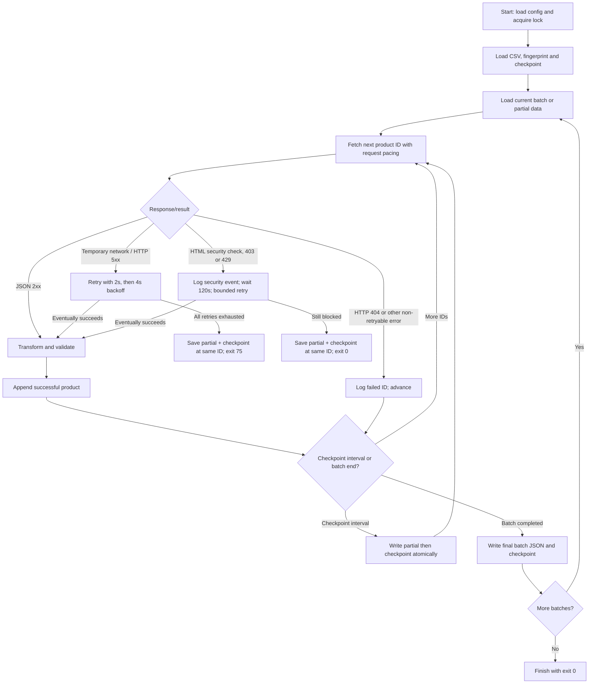

# 02 — ETL code flow and checkpoint recovery

## High-level call graph

```text
main.py / main()
  ├─ load_settings()                         app/config.py
  ├─ acquire .pipeline.lock (Linux flock)
  └─ run_pipeline(settings)                  app/pipeline.py
       ├─ pandas.read_csv(..., id=str)
       ├─ fingerprint_ids()                  app/storage.py
       ├─ load_checkpoint() + validate_previous_batch()
       └─ for each batch of BATCH_SIZE input IDs
            ├─ load_batch() → partial state or empty list
            └─ for each remaining ID
                 ├─ ProductClient.fetch()    app/client.py
                 │    ├─ pace request STARTS by REQUEST_DELAY
                 │    ├─ subprocess.run(curl ...)
                 │    ├─ parse HTTP status and JSON
                 │    └─ bounded retry for transient failures
                 ├─ transform_product()       app/transform.py
                 ├─ append valid product OR log_failure()
                 └─ save_progress() every CHECKPOINT_EVERY IDs
            └─ finish_batch() → final JSON + checkpoint
```

## Decision flow



The diagram simplifies the inner retry loop; exceptions thrown during transformation are logged as ordinary errors and advance to the next ID.

## Request pacing versus retry backoff

`ProductClient._pace()` targets a minimum interval of `REQUEST_DELAY` seconds **between request start times**, including retries and across batch boundaries. This is not a sleep of exactly one second after each response. The current measured configuration is roughly one input ID per second at `REQUEST_DELAY=1` when requests complete quickly.

Transient failures are selected by the client (HTTP 5xx and particular cURL failures such as timeout). The default `MAX_NETWORK_RETRIES=2` means **3 total attempts**, with `RETRY_BASE_DELAY=2` producing waits of 2s and 4s. The normal request pacing also applies to retry attempts.

Security-check handling is separate: defaults are a 120-second wait and up to 2 retries, then an intentional pause/stop if the access check persists. Do not increase request rates to evade a security challenge.

## Durable state

`checkpoint.json` stores (conceptually):

```json
{
  "next_index": 1250,
  "batch_size": 1000,
  "total_ids": 200000,
  "ids_fingerprint": "<sha256 of ordered product IDs>"
}
```

- `next_index` is a **zero-based cursor**: the index of the next ID to process. Therefore, terminal position = `next_index + 1`.
- `ids_fingerprint` hashes IDs **in order**, so changing ID values or reordering the CSV is detected.
- Resume rejects a changed `BATCH_SIZE` or changed input length; old legacy checkpoint files without a fingerprint can be accepted but cannot retroactively verify past CSV order.

While a batch is incomplete, `products_NNN.partial.json` contains `batch_start`, `next_index`, `ids_fingerprint`, and the products already accepted from that batch. It is a **state object**, unlike a completed `products_NNN.json` file, which is an **array of products**.

## Write ordering and crash safety

At a periodic checkpoint, `save_progress()` writes the partial JSON **first**, then the checkpoint. JSON writes use a temporary file, flush/fsync and atomic replacement.

At batch completion, `finish_batch()` writes a complete partial, writes the final `products_NNN.json`, saves the checkpoint, then deletes the partial. Startup can recover certain interrupted finalizations and checks the previous completed output.

A clean `Ctrl+C` / handled `SIGTERM` saves progress immediately. A `SIGKILL`, power cut or forced shutdown cannot be handled: at most approximately `CHECKPOINT_EVERY - 1` recently processed IDs may need to be fetched again, and append-only logs can contain repeated error events. This is **at-least-once processing near a crash**, not a strict exactly-once guarantee.

See [Recovery](08-recovery.md) before manually editing checkpoint or partial files.
